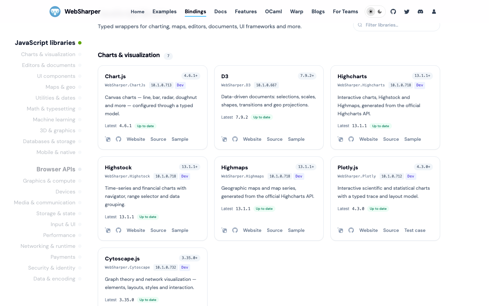
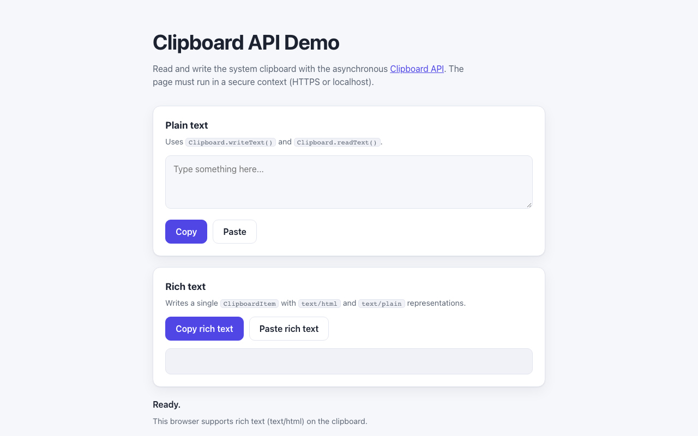
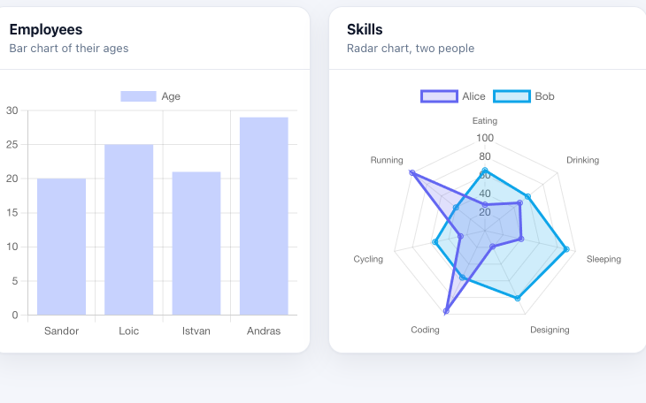
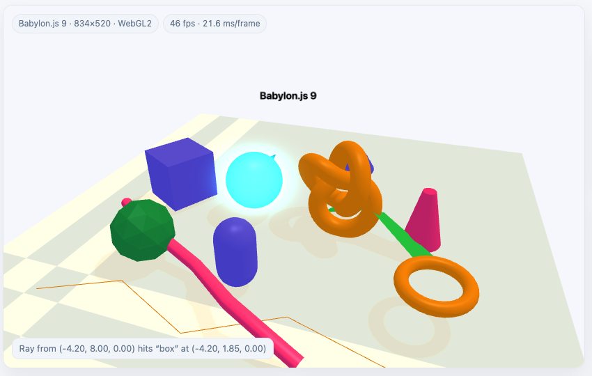
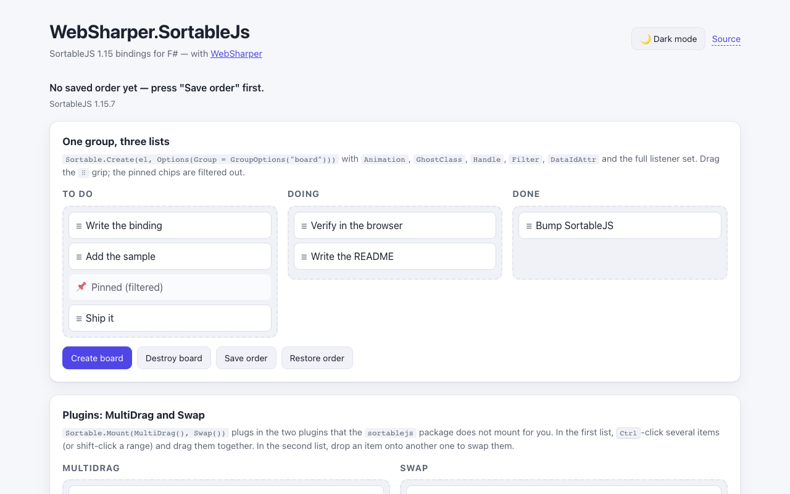

Every WebSharper application eventually reaches for JavaScript. A chart, a map, a rich-text editor, the clipboard, a service worker - the binding is the thin, strongly typed layer that lets you call it from F# or C# without giving up the compiler. A binding is a promise: the typed surface you compile against is the JavaScript that actually ships, down to the option names, the return types and the shape of the async calls. Keeping that promise is what the recent modernization was about.

Over the past several weeks we brought that layer back in line with the promise. The goal was not to rewrite every binding - most of the typing was already sound - but to agree on what a trustworthy binding looks like, apply it across the set, and put the whole thing behind an automated build and a public catalog. This post is a tour of the result, the conventions we settled on, and what faithful transliteration of an API actually requires.

## The checklist we settled on

The most useful outcome is not any single binding but a repeatable recipe. A modern binding now has the same shape everywhere:

| Piece | What it does |
| --- | --- |
| Binding project | `WebSharper.<Name>`, `netstandard2.0`, a WIG `Main.fs` or `Definition.fs` that builds the typed surface |
| npm surface | `Import` / `ImportDefault` from the npm package, pinned as `>= <ref> < <next-major>` |
| Extensions | an optional `WebSharper.<Name>.Extensions` assembly for the `[<Inline>]` glue that WIG cannot express |
| Sample | a WebSharper.UI app that exercises the whole surface, light-themed by default with a light/dark switcher |
| Packaging | Paket; the binding (and Extensions) DLLs and their XML docs; WebSharper 11 sidecars on the default branch |
| Documentation | README with install, usage, a live demo, a screenshot and a test-case link; Apache 2.0 |
| CI | GitHub Actions: Paket restore, Release build, GitHub Pages deploy from the default branch |
| Release lines | `main` targets the current line (WebSharper 11 preview, .NET 11); older lines stay as branches such as `websharper100` (WebSharper 10, .NET 10) |

Two details matter more than they look. First, **bindings are npm-based**. Some older bindings loaded a library from a CDN `<script>` tag, which made the binding depend on a URL that someone else controls. Today the binding imports the npm package and pins the upstream range, so the JavaScript you get is the JavaScript the types were written against.

Second, **the sample is the test case**. A sample that calls one method is documentation; a sample that exercises the whole surface is evidence that the binding can be trusted. We require the latter: every widget, every optional field, every failure path - including the "not available in this browser" path - and a real screenshot captured from the running page. That is what makes a green build meaningful.

## By the numbers

The current catalog lists **42 JavaScript libraries** and **41 browser APIs**, spread over ten library categories - charts and visualization, editors and documents, UI components, maps and geo, utilities and dates, math and typesetting, machine learning, 3D and graphics, databases and storage, and mobile and native - and ten browser-API categories: graphics and compute, devices, media and communication, storage and state, input and UI, performance, networking and runtime, payments, security and identity, and data and encoding. It is a snapshot of a set we keep extending, not a finished list - and extending it has become close to trivial: with the skill file in hand, an AI agent can scaffold a faithful binding for a new library in a single pass. Across the current set:

- 29 browser-API bindings were modernized in three batches, from Background Fetch and the Clipboard API through Service Workers, Push and IndexedDB.
- The build registry now drives **91 projects**, including core, UI and the ASP.NET Core integration.
- The larger library families - charting and mobile - are generated from their published metadata rather than hand-typed member by member.
- The work spans several hundred commits across the individual repositories.

<figure style="text-align: center;">
  
  <figcaption style="font-size: 0.9em; opacity: 0.7;">
    Figure 1: The catalog at websharper.com/bindings, with the bound upstream version, the NuGet package and the freshness check on every card.
  </figcaption>
</figure>

## Browser APIs: typed as the browser defines them

Browser-API bindings are small but unforgiving. The surface is defined by the browser, not by a library release, and it differs from engine to engine. For each binding the work starts with the current MDN surface - its Baseline status, whether it needs a secure context or a permission, what each return type and optional argument really is - and ends with the typed surface matching it. A binding you can trust has to express the awkward parts too: the permission state, the optional result, the case where the API is simply not available in this browser.

Service Worker is the best illustration, because the interesting half of the API runs in the worker rather than on the page. The Push sample compiles the service worker itself in F#, so its lifecycle, clients and notification handling are checked by the same compiler that checks the rest of the app:

```fsharp
[<JavaScript>]
module WorkerEntry =
    open WebSharper.ServiceWorker
    open WebSharper.Push.Extensions

    let EntryPoint (self: DedicatedWorkerGlobalScope) =
        let scope = As<ServiceWorkerGlobalScope> (box self)
        scope.OnInstall <- fun _ -> scope.SkipWaiting() |> ignore
        scope.OnActivate <- fun _ -> scope.Clients.Claim() |> ignore
        scope.OnPush <- fun event ->
            let body = payloadText (As<PushEvent> (box event))
            let options = new NotificationOptions(Body = body, Tag = "websharper-push-demo")
            event.WaitUntil(scope.Registration.ShowNotification("Push received", options))
        scope.OnNotificationClick <- fun event ->
            closeNotification event
            scope.Clients.OpenWindow("../../") |> ignore
```

The `Worker` constructor compiles that entry point into a standalone ES module, and registering it with `{ type: "module" }` is all the glue the page needs. The accessors that the ServiceWorker binding leaves as `obj` or does not model (`pushManager`, `closeNotification`) live in a small Extensions assembly, so even those are typed at the call site. A handful of platform details are documented next to the sample - `scriptBaseUrl` has to match the generated script path when `outputDir` is customized, a worker's scope is its script's directory, `permissionState` needs `UserVisibleOnly = true`, and `getSubscription` resolves to `null` rather than `undefined` - which is exactly the kind of knowledge that lets you trust the binding in a real deployment.

<figure style="text-align: center;">
  
  <figcaption style="font-size: 0.9em; opacity: 0.7;">
    Figure 2: The Clipboard API sample. It reads and writes the system clipboard, and reports the plain-text fallback when the browser does not support the rich-text path instead of failing silently.
  </figcaption>
</figure>

## Library bindings: a faithful transliteration of upstream

For established bindings the work was incremental on purpose. Take the existing WIG, compare it against the upstream surface, and make the definition a faithful transliteration. A rewrite would have thrown away years of small compatibility decisions; a diff keeps them reviewable.

<figure style="text-align: center;">
  <div style="display: flex; flex-wrap: wrap; gap: 10px; justify-content: center; align-items: center;">
    
    
    
  </div>
  <figcaption style="font-size: 0.9em; opacity: 0.7;">
    Figure 3: Three of the visualization samples - D3 (a world map), Chart.js (bar and radar charts) and Babylon.js (a lit 3D scene). Each is the binding's own test case.
  </figcaption>
</figure>

| Binding | Targets | What a faithful binding has to carry |
| --- | --- | --- |
| D3 | 7.9 | The surface re-expressed from the upstream `src/index.js`, with ESM output |
| math.js | 15.2 | `Math.Bignumber` returning `MathNumber`, so arithmetic stays with the library instead of the host language |
| jsPDF | 4.2.1 | The exact npm specifier (`jspdf`) that the default import resolves |
| highlight.js | 11.12 | The argument shapes of `Hljs.Highlight` and `HighlightAuto` |
| FullCalendar | 6.1 | The implementation classes behind their `/internal` subpaths |
| SortableJS | 1.15 | Variadic `mount`, and plugin constructors constructed before use |
| TinyMCE | 8.10 / 6.8 | Two packages, split by license (6.x MIT, 8.x GPL or commercial) |

<figure style="text-align: center;">
  
  <figcaption style="font-size: 0.9em; opacity: 0.7;">
    Figure 4: The SortableJS sample doubles as its test case: the board, the MultiDrag and Swap plugins, the option set and the version it is running against all live on the same page.
  </figcaption>
</figure>

A binding earns trust by being a transliteration, not a paraphrase. The subtle cases are the ones worth calling out, because none of them is visible in the F# signature alone. In math.js, `Bignumber` has to return the binding's `MathNumber` rather than a .NET `BigInteger`: otherwise F# `+` emits JavaScript `+`, and a numeric result quietly becomes a string. jsPDF's default import needs the exact `"jspdf"` specifier to resolve at all. SortableJS mounts its plugins variadically and expects the plugin constructors, so the faithful call is `Sortable.mount(new MultiDrag(), new Swap())` rather than an array of instances. FullCalendar's implementation classes live behind `/internal` subpaths because that is where the package actually exports them, and its 7.x line is a types-only stub, which is why the binding targets 6.1 by design. Each of these is a detail the binding has to carry from the JavaScript to the typed surface, unchanged.

And licensing is part of that faithful description. TinyMCE 7 and 8 are GPL-2.0-or-later or commercially licensed; 6.x is MIT. Rather than quietly changing the terms for existing users, the repository ships two packages, `WebSharper.TinyMce6` and `WebSharper.TinyMce`, with the license difference documented in both READMEs. We checked the upstream license for every modernized binding and called out any copyleft or commercial terms instead of assuming the binding's Apache 2.0 covers the library.

## Generated bindings: when the API is too big to type by hand

A hand-written definition is not the only way to get a faithful binding. Two families are generated instead.

Highcharts is generated rather than hand-written. Its generator rebuilds the model from the live documentation, imports the npm **ESM** builds (the UMD entry points cannot be side-effect imported in a bundle), and emits a `Modules` class so that optional chart modules are an explicit call rather than a missing feature.

The Capacitor mobile libraries are the same idea at a larger scale. Each plugin publishes TypeScript declarations, and the binding is generated from them, family by family - the same typed surface a person would write, kept in step with upstream by construction. The generator does not remove judgement: choosing which plugins to bind, which types to expose and where a gap is acceptable is still a design decision. It just makes that decision once, in one place, and applies it consistently from then on.

## One build stack, a branch per release line

The repositories used to have a build script each, with slightly different ideas about packaging and deployment. They now share the build stack: a single `repos.yml` registry lists the projects, the build presets and the groups, and the workflow clones, restores, builds, packages, bumps and tags from that registry. Adding a binding is a one-line change; a binding that stops building fails the stack before it reaches a user.

Each binding repository keeps its release lines as branches, with `main` tracking the line that is current for that repository. Right now that means `main` targets the upcoming WebSharper 11 (in pre-release, built on .NET 11), while a `websharper100` branch keeps the stable WebSharper 10 line (built on .NET 10) alive. That is a consequence of standing between the two lines, not a WebSharper 11 invention: many repositories have older branches of exactly the same shape - `websharper50` and so on - each preserving what the binding looked like on the line it was cut from, so the branches double as the version history of the binding's API in each release.

The difference is not only the compiler version. WebSharper 11 writes the binding metadata to a `<Assembly>.websharper` sidecar, so the package template lists it on `main` and omits it on the `websharper100` branch, where the metadata is embedded in the DLL. Paket handles the restore on both lines, and the GitHub Pages workflow publishes each sample so the demo in the README is the sample that was just built.

This is the least visible part of the effort and probably the most valuable: the catalog's version badges, the two NuGet feeds, the live samples and the sidecar packaging all depend on this machinery being identical across dozens of repositories.

## An AI-ready binding workflow

The last piece is about how new bindings get written. WIG is a good medium for that, because it is a good medium for people: a definition is structured metadata - classes, options, enums, arity, optionality - so it can be read, reviewed and diffed like code, and a compiler, a generator or an AI agent can work with it without guessing. What the medium asks for in return is faithfulness: the definition has to be a true transliteration of the JavaScript, not a summary of it.

The public [skill file](https://websharper.com/Assets/websharper-binding-skill.md), downloadable from the Bindings page, is the generic edition of the workflow we use internally. It covers the project layout, the WIG shapes (classes, `Pattern.Config`, `Pattern.EnumStrings`, `!?`, `!|`, `+`, `^->`, `T<Promise<'T>>`), the Extensions assembly rule, the sample conventions, the common pitfalls (`Import` on a special member, `Unchecked.defaultof`, `ws-var` on a `<p>`, stale template caches), and the definition of done. Hand it to Claude Code, Cursor, Codex or any agent that reads skills and ask for a binding for a library; you get a scaffold that follows the same recipe as the hand-written ones. And because the medium is unambiguous, the result has something concrete to be checked against.

The skill also states the checks we care about, because a binding is only trustworthy once it has been verified: inspect the generated JavaScript for the low-level calls you expect, render the sample in a real browser, and check the upstream license before publishing. The generated library families above are what that same approach looks like at scale.

## Finding a binding

The catalog is part of the website. It is built from each binding's own repository metadata - the package, the repository, the upstream version - and refreshed against NuGet and npm, so the page, the package and the sample all agree with one another rather than drifting apart.

Each card shows three distinct versions, because they answer three different questions: the **NuGet package version** you install, the **bound upstream version** the binding targets (for example `4.6.1+`), and the **latest npm release** for the freshness check. The card also links to the library's site, the binding source, and either a sample or a test case. When a binding has no pinned upstream version, it says so instead of pretending to be current - which is the same honesty the binding itself is held to.

## What is next

The work is not finished. The catalog is a snapshot of our current set, not a closed list: we are expanding it to cover the JavaScript libraries that have become highly successful and relevant recently, and keeping the existing bindings faithful as their upstreams move. The infrastructure is in place to make each addition a small, verifiable change rather than a project.

If there is a JavaScript library you use from WebSharper and want typed properly, open an issue on the binding repository - or hand the skill file to your agent, send us the result, and we will help you land it.

## Further reading

- [The bindings catalog](https://websharper.com/bindings)
- [Examples and live samples](https://websharper.com/examples)
- [Interface Generator documentation](https://docs.websharper.com/core/interface-generator)
- [The WebSharper GitHub organization](https://github.com/dotnet-websharper)

Happy coding!